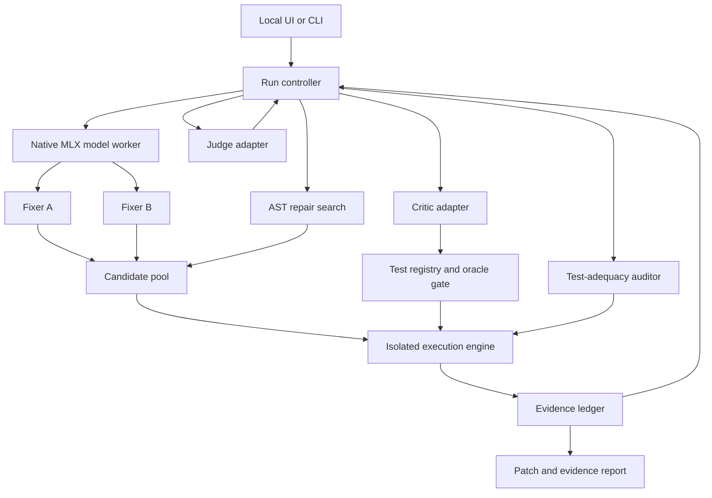

# CodeJury — Finalized Project Architecture

**Version:** 2.0 · **Date:** 11 October 2026  
**Architecture:** Complementary repair agents with mutation-audited counterexample investigation  
**Target:** Local application on an Apple Silicon Mac; Python program repair  
**Document boundary:** Architecture and research design. Installation commands, implementation tasks, sprint plans, and build prompts belong in the next document.

**Reading guide:** Sections 1–4 establish the design; Section 5 specifies every component; Sections 6–8 describe protocol and interfaces; Section 9 defines learning; Sections 10–12 cover Mac execution and free alternatives; Sections 13–16 define research and observable outcomes. References are in Section 18.

## 1. Project definition

CodeJury repairs a faulty Python function by combining learned repair agents, targeted code search, and executable investigation. Two complementary Fixers propose candidates. A Critic designs tests that distinguish candidates or challenge their shared assumptions. A Judge chooses which investigation to perform next and selects an eligible patch. A deterministic controller, isolated execution engine, and evidence ledger enforce the rules.

The additional component in this architecture is a **test-adequacy auditor**. It uses controlled code mutations to expose behaviours that current tests do not distinguish, then directs further investigation toward those gaps. Mutation testing is established; the proposed contribution is its use as feedback to a learned repair-investigation policy alongside complementary adapters.

The product returns a candidate patch, a code diff, execution evidence, and the remaining uncertainty. It can also return an unresolved outcome. Passing tests is reported as passing tests, never as a mathematical proof of correctness.

**Research question:** Can failure-specialized repair adapters and mutation-audited investigation improve final repair correctness relative to a strong single-agent system with the same tools and comparable inference resources?

**Intended advantage:** Recover from three distinct failures: an incorrect algorithmic approach, a nearly correct implementation with a small expression error, and agreement between agents on a patch that passes weak tests.

This document finalizes the component boundaries and learning objectives. Accuracy gains, Mac throughput, training duration, and research novelty are hypotheses or measurement outcomes, not established results.

## 2. Final architectural decisions

| Decision | Final choice | Reason |
|---|---|---|
| Learned roles | Four: Fixer A, Fixer B, Critic, Judge | Each has a distinct information view and learning target |
| Model topology | One frozen base with four separate LoRA adapters | Supports role specialization without four resident base models |
| Base model | Phi-4-mini-instruct, 3.8B, quantized to 4-bit for the Mac profile | Preserves the original project choice and has an available MLX conversion [S1–S3] |
| Base-model contingency | Qwen2.5-Coder-3B-Instruct if the selected Phi configuration fails compatibility or validation checks | A coding-focused alternative; switch the whole experiment, never silently mix results [S4] |
| Fixer diversity | Different information access plus failure-focused training for B | Directly targets useful complementary successes |
| Debate | Structured claims, counterexamples, and revisions | Produces verifiable changes in evidence |
| Small-edit repair | Bounded AST search over selected sites and operator families | Explores nearby repairs systematically |
| Testing | Supplied tests, approved properties, differential exploration, and shrinking | Finds failures beyond examples without treating a model's answer as truth |
| New research component | Test-adequacy auditor feeding mutation gaps to Critic and Judge | Makes test selection responsive to observed blind spots |
| Investigation | Learned Judge selects actions; deterministic controller validates them | Separates learned decisions from hard execution and acceptance rules |
| Runtime | Native macOS model worker; isolated Linux execution worker | Keeps Apple acceleration available while isolating generated code |
| Storage | Local SQLite metadata plus immutable content-addressed files | Replays decisions and prevents candidate/test identity confusion |
| Cloud requirement | None for inference, training, or UI | Paid teachers are optional accelerators, with a local data-generation route |
| Main learning method | SFT and action-outcome supervision | All four roles can be trained without requiring a new RL framework |
| Research extension | RL refinement of investigation decisions | Optional experiment; not a prerequisite for the finalized system |

The contingency changes the backbone, not the architecture. Within any reported comparison, freeze the exact model revision, tokenizer, quantization, and adapter configuration.

## 3. Scope and behavioural assumptions

### Supported project scope

- One deterministic Python function, optionally with a small explicitly supplied helper bundle.
- A fixed function signature, a natural-language contract, structured input-domain constraints, and supplied tests.
- Logic bugs: incorrect conditions, boundaries, aggregation, loop updates, state transitions, early returns, and some algorithmic errors.
- An initial supported value domain of integers, booleans, strings, lists, and string-keyed dictionaries. Other types require explicit codecs and comparison rules.
- Standard-library dependencies from an approved allowlist. All allowed dependencies are fixed before a repair run.
- Python 3.11 as the initial project runtime, subject to dependency compatibility validation and version locking.

### Deliberate scope boundaries

Full repositories, package installation during repair, external services, database migrations, concurrency bugs, nondeterministic programs, and performance-only repairs are outside this version. Unspecified floating-point tolerance, aliasing, in-place mutation, exceptions, and input ordering are treated as contract questions rather than guessed semantics.

The default contract is pure-function behaviour: no external effects and no input mutation. Functions with specified in-place effects need explicit before/after assertions and are a separate evaluated subset. A candidate that attempts disallowed effects is ineligible even if its return values look correct.

The scope is narrow enough to support reliable execution and broad enough to evaluate nontrivial repair. Simple one-line examples demonstrate the UI but are not the entire benchmark.

## 4. System topology

The adapter boxes are logical roles on one model worker, not four simultaneous model processes. Role requests execute sequentially in the default Mac profile. Independence refers to information access and candidate generation, not parallel GPU execution.

The controller is the only component permitted to create runs, admit tests, schedule execution, apply budgets, or publish final results. Agents issue typed proposals; they never execute shell commands or mutate the test harness directly.

## 5. Component responsibilities

### 5.1 Intake and contract registry

**Inputs:** source, signature, contract text, domain schema, supplied examples, allowed dependencies, and resource profile.

**Responsibilities:** parse source without importing it on the host; check supported syntax and size; record contract requirements; reproduce the supplied failure in isolation; detect inconsistent tests or unsupported inputs.

The registry assigns stable requirement IDs such as `preserve_order`, `preserve_multiplicity`, or a user-defined requirement. A model may suggest an interpretation, but an interpretation is not automatically an authoritative executable assertion.

For benchmark tasks, properties are reviewed and fixed before evaluation, using only the declared specification. For arbitrary user tasks, inferred properties remain proposals until approved. The UI asks about ambiguities only when they materially affect repair or acceptance.

**Outputs:** an immutable problem record, requirement registry, and original failure evidence. If the original failure does not reproduce, the run returns `invalid_input` or `unresolved` with the reason; it does not claim a repair.

### 5.2 Fixer A — targeted implementation repair

**Initial view:** buggy source, specification, supplied tests, execution trace, dependency contract, and signature.

**Output:** replacement function or helper bundle, concise diagnosis, referenced requirements, assumptions, and optional suspicious AST locations with proposed edit families.

A is trained to preserve useful implementation structure while correcting observed failure mechanisms. Small edits are a preference among otherwise supported candidates, not a proxy for correctness. A may make a larger change when the original algorithm is wrong.

Its initial candidate becomes the incumbent if it passes the current hard checks. The original buggy function is preserved as the episode's baseline, never mislabelled as an eligible repair when it still fails.

### 5.3 Fixer B — complementary reconstruction

**Initial view:** signature, intended behaviour, input domain, allowed dependencies and helper interfaces, and supplied examples. B does not initially see the buggy implementation, A's candidate, or A's diagnosis.

**Output:** an independently constructed candidate and its assumptions.

B uses the same base model with a separately trained adapter. Its training distribution emphasizes problems A frequently fails, while retaining ordinary problems. Independence and failure-focused data are separate experimental factors.

After initial candidates are committed, B can see concrete counterexamples and targeted revision requests. Its initial information boundary remains part of the saved episode, making the independence claim auditable.

B is a fallible solver, never a reference implementation. A missing helper contract or ambiguous behaviour cannot be repaired by guessing a specification.

### 5.4 Candidate pool and behavioural comparison

Each candidate is immutable and linked to its parent, author role, source hash, generation configuration, and edit description. Syntax normalization deduplicates identical code without deleting provenance.

Execute candidates on a common probe set. Build a behavioural signature from normalized outputs, allowed input effects, exception classes, and timeouts. Equal signatures indicate equivalence only on the observed probes.

The pool preserves behavioural alternatives. It does not reward textual difference or assume that two different algorithms must behave differently. Search descendants count as separate candidates but are labelled as descendants rather than independent agent opinions.

When a new authoritative test arrives, it is eventually run against every candidate still eligible for selection. Cached results are reused only when candidate, test, runtime image, oracle version, and resource policy hashes all match.

### 5.5 Critic — experiment design

The Critic receives relevant candidates, requirement IDs, test outcomes, observed disagreements, and auditor gaps. It returns a **test proposal**, not an unconditional verdict.

Its modes are:

1. **Discriminate:** expose a meaningful difference between plausible candidates.
2. **Challenge agreement:** investigate a requirement all current candidates may violate.
3. **Explore an audit gap:** target a location or behaviour current tests fail to distinguish.
4. **Validate a revision:** attack the assumption introduced by a new patch.

A proposal contains a requirement reference, an input or declarative input family, an oracle proposal, and a short rationale. Prefer structured generators over arbitrary generated test programs. A vetted generator registry supports length ranges, integer intervals, duplicates, ordering patterns, empty/singleton cases, and combinations within the declared domain.

The engine executes generated inputs and shrinks discovered failures while preserving input-domain validity. Hypothesis supplies generation and shrinking capabilities; CodeJury owns the orchestration and evidence rules [S6].

A Critic can report that it found no useful challenge. That output neither proves correctness nor automatically stops the run.

### 5.6 Oracle gate and property registry

The oracle gate separates observations from correctness judgements.

| Oracle status | Example | Permitted effect |
|---|---|---|
| `authoritative` | Supplied expected output; reviewed executable property | A reproducible violation can make a candidate ineligible |
| `proposed` | Expected output generated by the Critic from prose | Can guide exploration; cannot alone disqualify or certify a patch |
| `observation_only` | A and B return different values | Identifies uncertainty; supplies no winning answer |
| `rejected` | Out-of-domain input or disproven expectation | Excluded from acceptance and training rewards |

A source field separately records `user`, `reviewed_contract`, `model`, or `training_reference`. Runtime roles cannot create or access `training_reference` or hidden evaluation evidence.

A model citing a contract sentence does not make its inferred expected value authoritative. A supported property template needs a reviewed mapping from that requirement to its executable meaning. For instance, a sorting contract can justify both monotonic output and multiset preservation. Idempotence alone is insufficient: an always-empty function can be idempotent.

Discovered inputs can have authoritative checks without exact expected outputs when they instantiate an established property. Differential disagreement and metamorphic relations are not automatically truth; each relation must be justified for that task.

Conflicting authoritative assertions suspend acceptance and produce a contract-conflict event. They are not resolved by majority vote between agents.

### 5.7 Targeted AST repair search

This engine systematically explores small edits around the original program or a near-correct candidate. The model nominates edit sites and families; passing/failing execution evidence also supplies location hints. Neither hint is proof that a location is faulty.

Supported initial operator families are comparison replacement, boundary constant adjustment, Boolean condition negation, arithmetic operator replacement, and replacement of a variable reference with a compatible in-scope variable. An explicit search request fixes sites, allowed families, depth, and candidate budget.

Search begins with one edit per candidate. A bounded two-edit beam is permitted when configured and charged to the same budget. Parse every result; reject invalid signatures, unknown names, disallowed imports, and unsupported effects before execution.

Run previously failing authoritative tests first, then regression tests, then generated authoritative tests. Partial pass counts prioritize exploration but cannot qualify a final candidate. All existing hard tests must pass before eligibility.

Search produces patch candidates. It does not modify the user's original source, test files, contract, or harness. It cannot insert test-specific constants or branch on test identities. This is a bounded synthesis component, not exhaustive search over all Python programs.

Hybrid LLM/program-analysis repair has prior evidence, including GIANTREPAIR [S14]. That supports this design direction without establishing CodeJury's results.

### 5.8 Test-adequacy auditor — the additional research component

**Purpose:** identify observable test blind spots and steer investigation toward them, including when both Fixers agree.

The auditor reuses the AST transformation infrastructure but has a different output and purpose from repair search. It creates **probe mutants** of an eligible candidate, executes them against authoritative tests, and records what those tests distinguish.

| Probe outcome | Meaning |
|---|---|
| `invalid` | The edit cannot produce a supported executable program |
| `killed` | An authoritative test rejects the mutant |
| `survived` | Available authoritative tests do not reject it |
| `timeout` | Resource-limited observation, recorded separately |
| `duplicate` | Exact normalized duplicate, omitted from further sampling |

A survivor may be equivalent, outside the tested region, a genuine gap, or even a better implementation. A survivor is therefore **not evidence that the original candidate is wrong**. No component treats every mutant as intentionally incorrect. Behavioural similarity on samples is not proof of equivalence.

The auditor outputs a gap record: candidate version, AST location, mutation family, tests covering or exercising it, survivor IDs, and associated requirement IDs if known. The Critic uses it to propose a distinguishing input. The oracle gate then decides whether the resulting observation can establish a failure.

For example, tests exercising only strictly interior numeric values may not distinguish `>` from `>=`. The auditor can reveal that the boundary relation is unresolved. The Critic then proposes the boundary input, and the explicit contract establishes the expected behaviour.

**Proposed test-selection policy:** prefer valid tests that expose new requirement violations or new behavioural distinctions across candidate/mutant families, with a diversity bonus and an execution-cost penalty. Raw mutant kill count is never a correctness score. Group near-identical mutants by location/family so creating many easy mutants cannot inflate usefulness.

**Learning signal:** during training, assess whether auditor-guided actions improve final repair selection on a separate assessment suite. Reward downstream correctness, not merely killing more mutants. Count invalid properties and false rejections as harmful actions.

**Preventing self-confirmation:** the incumbent's output is not used as a correctness oracle. A differential probe can reveal a gap, but only established contract evidence can invalidate a candidate. Probe mutants are not admitted to the patch pool automatically; a promising survivor must pass through the normal candidate-admission path.

Mutation testing itself is established [S15]. The specific hypothesis is that exposing mutation-gap state to a learned Judge and Critic yields more useful investigations than generic critique, ordinary fuzzing, or mutation testing appended only at the end. This is a proposed contribution, not a first-of-its-kind claim.

### 5.9 Judge — learned investigation policy

The Judge sees a structured state rather than the entire conversational history: eligible and rejected candidate IDs, behavioural groups, authoritative counterexamples, unresolved requirement IDs, mutation-gap summaries, previous action outcomes, and remaining resources.

Allowed actions are `generate`, `criticize`, `search`, `audit`, `revise`, `select`, and `abstain`. `criticize` identifies its mode and target requirement or candidate pair. `select` names an existing candidate ID; it contains no new code.

The Judge decides whether the next useful step is another solution, another test, a local search, or stopping. A deterministic action validator checks IDs, prerequisites, budgets, and state. A stale or invalid selection is refused.

A rejected candidate can be revised, but cannot be selected. When A's incumbent remains eligible and new evidence does not establish a reason to prefer an alternative, the tie-break preserves it. This limits unsupported replacement without guaranteeing hidden-test non-regression.

The report uses an evidence-based status, not an uncalibrated model confidence percentage. Calibration is a separate optional analysis on validation data.

### 5.10 Execution engine and evidence ledger

Candidate imports, tests, traces, generated assertions, and mutations execute only inside the isolated worker. The host never imports candidate modules. Each test invocation uses fresh function state and copied inputs. Untrusted code cannot access the model worker, teacher credentials, host home directory, or container control socket.

Record return value, allowed input effects, exception, timeout, duration, exit status, and bounded trace data. Function-level tracing records selected local-variable snapshots and executed locations; full unbounded traces are prohibited by resource policy.

SQLite stores run metadata and indexed event records. Source, test definitions, bounded execution artefacts, and model outputs are stored as immutable files referenced by hashes. Every Judge action and rejection reason is retained. Facts are generated from runner results; explanations cannot overwrite them.

## 6. Runtime protocol and stopping rules

1. Validate the request, freeze the contract, and reproduce the original failure.
2. Generate A and B independently with the information boundaries above.
3. Parse, deduplicate, execute, and group candidates by observed behaviour.
4. If no candidate is eligible, request targeted search or a counterexample-based revision.
5. If multiple candidates remain, investigate consequential disagreement. If they agree, challenge shared assumptions or audit unresolved behaviours.
6. Admit valid tests through the oracle gate; execute them against relevant candidates and propagate new authoritative tests to all selection-eligible candidates.
7. Preserve counterexamples, create new candidate versions, and repeat within the run budget.
8. Select only after final eligibility checks. Terminate unresolved when no eligible candidate remains, essential semantics are missing, or the budget expires without a defensible selection.

### Final output states

| State | Meaning |
|---|---|
| `supported_patch` | The selected candidate passes all authoritative acceptance checks completed for this run; verification scope is disclosed |
| `unresolved` | No eligible repair, contradictory contract, or material unresolved semantic choice; reason recorded |
| `invalid_input` | Malformed or unsupported problem, or invalid supplied tests |
| `infrastructure_error` | Model, runner, or persistence failure prevented a valid decision |
| `cancelled` | User cancellation; partial evidence remains available |

An eligible patch can still be returned with remaining untested requirements if the report explicitly marks the scope; the decision policy must not describe that as full verification. If surviving candidates disagree on an essential unspecified requirement, return unresolved rather than conceal that choice.

An audit target is not a mandatory 100% mutation-score threshold. Equivalent mutants make that threshold inappropriate. Stop based on explicit budgets and a lack of useful admissible actions, while preserving the remaining gaps in the report.

## 7. Core data contracts

These are architecture-level interfaces. Exact generated JSON Schema and implementation types belong in the build document. All records contain `schema_version`; IDs are controller-generated; timestamps use UTC; hashes identify exact content.

| Record | Required fields |
|---|---|
| `Problem` | `problem_id`, `source_hash`, `signature`, `contract_text`, `domain_schema`, `requirements`, `supplied_test_ids`, `allowed_dependencies`, `resource_profile` |
| `Requirement` | `requirement_id`, `description`, `source`, `approval_status`, `property_template_id` or null, `parameters` |
| `Candidate` | `candidate_id`, `problem_id`, `parent_id` or null, `origin`, `source_hash`, `diagnosis`, `requirement_ids`, `model_config_hash` or null, `created_event_id` |
| `TestProposal` | `proposal_id`, `requirement_ids`, `generator_spec` or `concrete_inputs`, `oracle_spec`, `rationale`, `target_candidate_ids` |
| `TestCase` | `test_id`, `input_codec_version`, `inputs`, `oracle_spec`, `oracle_status`, `oracle_source`, `domain_valid`, `requirement_ids`, `provenance` |
| `Execution` | `execution_id`, `candidate_id`, `test_id`, `runtime_hash`, `actual_output`, `input_effects`, `exception`, `outcome`, `duration_ms`, `trace_ref` or null |
| `AuditGap` | `gap_id`, `candidate_id`, `location`, `operator_family`, `mutant_ids`, `observed_outcomes`, `requirement_ids` |
| `InvestigationAction` | `action_id`, `kind`, `target_ids`, `requirement_ids`, `evidence_ids`, `parameters`, `requested_budget`, `rationale` |
| `RunResult` | `run_id`, `status`, `selected_candidate_id` or null, `verification_scope`, `unresolved_requirements`, `evidence_ids`, `resource_usage`, `termination_reason` |

`oracle_spec` is a tagged union: literal expected output, established property-template invocation, approved metamorphic relation, or observation-only. Values use an explicit JSON codec; NaN, arbitrary Python objects, and implicit tuple/list conversion are not silently accepted.

An execution `outcome` is `pass`, `fail`, `timeout`, `error`, or `observed`. Observation-only tests cannot emit an authoritative pass/fail. Infrastructure errors do not count as semantic failures. A timeout can reject a candidate only under the declared resource contract and reproducibility policy.

Candidate eligibility is derived from execution evidence, not trusted from an agent-supplied field. Requirement and oracle status changes require controller-authorized events, never free text from an agent.

## 8. Local application interfaces

The application is a localhost service with a browser UI and CLI clients. The model stays in a separate long-lived process so UI refreshes cannot reload it or alter run state.

| Interface | Purpose |
|---|---|
| `POST /runs` | Submit a validated problem and resource profile; return `run_id` |
| `GET /runs/{run_id}` | Return status, resource usage, and latest result |
| `GET /runs/{run_id}/events?after={event_id}` | Return ordered events for incremental UI updates |
| `GET /runs/{run_id}/candidates/{candidate_id}` | Return source, diff, provenance, and eligibility evidence |
| `POST /runs/{run_id}/cancel` | Stop scheduled work and terminate active execution safely |
| `GET /runs/{run_id}/report` | Export the evidence report and selected patch, if any |

Events include `candidate_created`, `execution_completed`, `test_admitted`, `test_rejected`, `audit_gap_found`, `action_selected`, `action_refused`, and `run_finished`. Each includes run ID, increasing event ID, type, timestamp, and typed payload.

Initial UI transport is event polling. Streaming model text is optional presentation; final decisions always reference persisted execution events. Only one active repair episode owns the model worker in the default Mac deployment.

## 9. Learning architecture

### 9.1 Data boundaries

Split by original problem and algorithm family before creating bugs, prompts, teacher traces, or repair episodes. Variants and near-duplicates remain in the same split. Keep training, validation, and final evaluation manifests immutable and hash their contents.

Training includes verified correct implementations, deliberately corrupted versions, and actual student mistakes. Mutation-derived tasks are labelled synthetic. Natural bugs form a separate reported subset.

A test passing a reference implementation is only empirical support for the test on that implementation; manually inspect ambiguous contracts and avoid claiming arbitrary generated properties are universally proven.

### 9.2 Fixer A training

Use SFT on buggy source, specification, visible tests, observed failure evidence, concise diagnosis, and verified repair. Include cases requiring both local and algorithmic changes. Prefer verified outcomes over polished explanations.

Reference solutions and training assessment tests are data-pipeline tools. They are not fields in the runtime `Problem` supplied to agents.

### 9.3 Fixer B training

Freeze A. Estimate its failure fraction `f_A(i)` across a small fixed number of generations for each training-pool problem. Weight B's sampling by:

`w_i = 1 + alpha * f_A(i)`

Tune `alpha` on validation data. B receives the reconstruction view, even when examples were selected because A failed. Correct targets come from reviewed source implementations or execution-verified repairs. Retain a substantial general-problem mixture to reduce overspecialization.

Checkpoint selection considers both B's standalone accuracy and the union of A/B successes. Do not reward disagreement, different wording, or orthogonal adapter weights: those do not establish useful semantic diversity.

### 9.4 Critic training

First learn valid domains and sound expectations. Then train on candidate pairs, shared incorrect candidates, and audit-gap records from actual student episodes. Include correct candidates for which no valid objection exists.

Useful targets include concrete counterexamples, generator specifications, correct rejection of invalid tests, and honest reports of unresolved semantics. Train and assess false-positive objections explicitly.

Execution-filtered SFT is required. Preference or RL refinement is optional. If added, penalize invalid expectations and rejection of correct solutions; raw test count and mutation kill count are unsuitable standalone rewards.

### 9.5 Judge training from alternative action outcomes

On training-only episodes, snapshot a state and explore several permitted actions with the same continuation policy and comparable remaining resources. Evaluate their final selected patches with an assessment suite unavailable to the policy. Use repeated continuations where sampling noise is material.

Label actions by final correctness, harmful rejection/selection, and resource use. An illustrative utility is:

`utility = correct_selection - lambda * incorrect_selection - mu * normalized_cost`

Abstention has a separately declared utility. Choose coefficients on validation data and report them. The assessment suite is still finite, so labels are empirical rather than proof of semantic correctness.

Train the Judge adapter to select actions from the available action set, referencing only visible evidence. Explanations are short summaries of that evidence. The model is not trained to infer hidden assessment outputs from leaked logs.

The operational comparator is a fixed controller with the same tools. The learned Judge remains in the final research architecture; a fixed-policy fallback allows diagnosis of whether poor results arise from tools or action selection.

### 9.6 Controlled offline iteration

Generate episodes, validate data, train one adapter, evaluate on validation tasks, and freeze a versioned checkpoint. The next collection round uses the frozen set. No adapter updates occur during final evaluation or a live repair run.

All adapters share the identical base-model revision and quantization configuration. Training data, configurations, and provenance are recorded locally. Report the effect of each iteration; do not presume that additional training improves results.

## 10. Mac execution and resource architecture

### 10.1 Supported target

The supplied project proposal names an M5 MacBook Pro with 16GB unified memory. This document uses that as the target assumption; no Mac benchmark has been run here. The supported accelerated path is Apple Silicon, with macOS and Python versions compatible with the pinned MLX release [S1, S17]. An Intel Mac is outside this accelerated training target.

Run MLX inference and adapter training natively on macOS. Run candidate Python execution in an ARM64 Linux VM managed by Colima, using its container runtime. The model is not placed in the Linux container. Colima provides a free Mac container-runtime route [S8].

### 10.2 Model worker

- One base model loaded at a time; one active adapter per generation.
- Maintain matching adapter module topology and replace the complete adapter parameter set on each switch. Fail closed on missing or incompatible keys.
- Use fresh generation state and KV caches between different adapters. Cache only with a key that includes base revision, adapter hash, tokenizer, prompt, and relevant configuration.
- Serialize role requests. Cancel and recover without leaving a partially switched model active.
- If correct in-place adapter replacement is unsupported in the pinned runtime, reload the model with the requested adapter sequentially. This preserves semantics at a latency cost; hot-swap latency is not assumed.

MLX-LM documents quantized fine-tuning and adapter-based generation, but this exact four-adapter worker requires compatibility validation [S1–S3]. The design does not assume a stock multi-adapter server or millisecond switching.

### 10.3 Planning profiles

These values are initial configuration proposals, not measured performance or guaranteed memory ceilings.

| Parameter | Default Mac profile |
|---|---|
| Context budget | Start at 4,096 tokens per call; evaluate 8,192 only after memory measurement |
| Fixer response cap | 1,024 generated tokens |
| Critic response cap | 512 generated tokens |
| Judge response cap | 192 generated tokens |
| Total generated-token cap | 10,000 per repair episode, including retries |
| Judge decisions | At most 8 after initial candidate generation |
| Learned candidates | At most 8, including revisions |
| AST search candidates | At most 48 per episode |
| Audit mutants | At most 24 per selected audited version; at most 48 total |
| Function executions | At most 3,000, including probes, shrinking, audit, and search |
| Episode deadline | 15 minutes; configurable and always reported |
| Single function-call timeout | 2 seconds for the bounded default domain |
| Execution VM | Initial allocation of 2 CPU cores and 2GB RAM |
| Candidate process | Initial 512MB memory limit, restricted process count, bounded output |
| Model concurrency | 1 |

Any limit can terminate exploration. Candidates with incomplete acceptance tests remain ineligible. Per-call limits are clipped to the remaining episode budget. The original/reference implementation must satisfy the chosen domain and time profile before benchmark use; otherwise adjust the profile before evaluation or exclude the task with a documented reason.

A 3.8B model's theoretical 4-bit weight payload is about 1.9GB; total memory also includes quantization metadata, activations, caches, adapter state, the VM, and macOS. This arithmetic is not a claim that training consumes 1.9GB.

### 10.4 Local training profile

Train adapters sequentially with a quantized frozen base. Start with microbatch 1, rank 8, short training sequences, gradient accumulation, and a selected subset of supported attention projections. Rank, adapted layers, sequence length, and checkpointing are validation-controlled settings. Inspect actual model module names; do not assume Phi and Qwen have identical target modules.

Stop the execution VM and unload other model processes during training when they are unnecessary. Training samples whose required context cannot fit are explicitly excluded or assigned to a larger profile; never truncate away the patch target silently.

The free local route includes all four adapters and the same runtime architecture. Its training duration and quality are unmeasured. Larger-memory Macs can increase batch/context sizes without changing the protocol. Optional rented compute can accelerate experiments but is not required by the product.

## 11. Execution isolation and failure handling

Generated code and tests run with network disabled, a read-only root filesystem, non-root identity, dropped capabilities, process and memory limits, bounded temporary storage, and an external watchdog. Use a dedicated VM profile without default personal-directory sharing; verify the effective mounts. Inputs are copied into an ephemeral job environment. Never mount the host home, credentials, source repository, or container socket into a candidate container.

Container restrictions and resource controls are documented by Docker [S9]. They reduce exposure but are not a formal security proof. This project targets a local academic tool, not an internet service executing hostile public submissions.

The trusted harness evaluates recorded outputs outside the candidate's process where possible. Submitted pytest-style tests, if supported, are also untrusted code and cannot serve as host control logic. Static AST restrictions are a scope filter, not the sandbox.

| Failure | Required behaviour |
|---|---|
| Malformed agent JSON | One bounded format-repair attempt, then action failure; charge all tokens |
| Invalid or stale Judge action | Reject with a typed reason; use logged deterministic fallback if permitted |
| Adapter load error | Restore a known model state or stop with infrastructure error |
| Memory pressure | Stop work and preserve the ledger; a changed profile becomes a separately recorded run |
| Candidate infinite loop | Kill the job process tree; record timeout and resource policy |
| Output or trace overflow | Truncate to explicit bounds and mark truncation |
| Contradictory tests | Suspend acceptance and report the contract conflict |
| Missing sandbox | Refuse candidate execution; no host-execution fallback |
| Invalid generated property | Quarantine it; it cannot reject candidates or supply positive training reward |
| No internet | Continue using downloaded weights, locked dependencies, and cached runtime images |

## 12. Technology choices and free alternatives

**No paid service is mandatory.** Free means no required software subscription or API charge; it does not mean zero electricity, storage, runtime, or manual-review effort. Verify licenses of the exact model and dataset revisions before redistribution.

| Need | Selected free route | Optional paid alternative | Trade-off |
|---|---|---|---|
| Local inference and training | MLX + MLX-LM [S1, S2] | Rented GPU training | Local jobs are slower; final inference stays local |
| Student weights | Phi-4-mini-instruct; Qwen2.5-Coder-3B contingency [S3, S4] | Proprietary hosted student | Hosted inference would change the local-product claim |
| Teacher data | Verified original solutions, controlled bugs, and sequential local teacher generation | Hosted strong-model API | Paid teachers can increase data quality/throughput; their outputs still need validation |
| Local teacher candidate | Qwen2.5-Coder-7B-Instruct, quantized and run separately from the student [S5] | Larger hosted teacher | Greater memory/time demand; must profile on the actual Mac; not assumed superior on every task |
| Lower-memory teacher fallback | Student self-sampling filtered by trusted training tests, plus reviewed correct source programs | Larger-memory hardware | Less teacher diversity and more manual curation; equal quality is not promised |
| Sandboxed runtime | Colima with Docker runtime/CLI [S8, S9] | Commercial desktop container product | Free route needs explicit VM/mount configuration |
| Test generation | Hypothesis + reviewed property templates [S6] | None required | Property quality remains a project responsibility |
| AST search and auditor | Python AST-based operators [S7] | None required | Purpose-built engine offers precise budgets and provenance |
| Local backend | FastAPI + Pydantic [S10, S11] | Hosted backend | Local typed requests keep experiments independent of a service |
| UI | Local HTML/JavaScript served by the backend | Hosted UI/platform | No hosting account required; presentation changes do not affect the research protocol |
| Storage and tracking | SQLite, JSONL, local files, Git | Managed database or experiment tracker | Requires local backups; no external telemetry dependency |
| Benchmark data | QuixBugs; reviewed custom problems; optional repair adaptations of EvalPlus tasks [S12, S13] | Proprietary datasets | Published generation tasks need explicit repair conversion and licensing review |

Free cloud credits are not the fallback guarantee: their availability, quotas, and terms can change. The reproducible free path is local. Provider names and model IDs for any optional paid teacher are configuration, not architectural dependencies.

A local teacher is never resident alongside the student during the default 16GB training-data-generation profile. Generate teacher outputs in a separate phase and unload it before student training or runtime evaluation.

## 13. Research contribution and novelty boundaries

### Contribution C1: complementarity learned from execution failures

Measure whether failure-focused B training adds repairs A cannot produce under comparable sampling effort. Report joint failure rate, rescue rate, and union success. Separate the effect of independent reconstruction from the effect of data weighting.

### Contribution C2: mutation-audited investigation

Expose concrete test blind spots to the Critic and Judge. Measure whether these signals lead to new valid counterexamples and improved final selection, particularly on initial A/B agreement cases.

### Contribution C3: action selection learned from repair outcomes

Train the Judge to choose among generation, testing, search, and audit using alternative-action training episodes. Measure final correctness per token and per elapsed time, accounting for execution cost.

These are hypotheses about a combined method. Existing work covers LoRA ensembles [S18], boosting-style correction [S19], counterexample-guided repair [S20], hybrid program-analysis repair [S14], and learned adversarial test generation [S16]. A related-work table in the eventual report must compare inputs, training objectives, oracle access, tools, and compute budgets. Do not claim that adapters, mutation testing, a Judge, or local execution are individually novel.

The most defensible distinction to investigate is the interaction: a complementary repair pool creates useful alternatives, mutation gaps expose uncertainty in their tests, and a learned policy chooses how to resolve that uncertainty. A comprehensive literature review and measured results are still needed before asserting publication-level novelty.

## 14. Evaluation architecture

### 14.1 Dataset strategy

QuixBugs is a secondary external benchmark, not a source for thousands of supposedly independent examples [S12]. Primary training comes from a larger separately curated collection of correct functions, controlled corruptions, and real student-generated mistakes.

Plan for at least 200 distinct held-out base problems for primary quantitative evaluation if the curated corpus supports it; this is a collection target, not available data. Report actual counts and narrower uncertainty when fewer problems are available. Keep multiple mutants of one original problem clustered in statistical analysis.

Optional HumanEval+/MBPP+ use through EvalPlus must be labelled a **repair adaptation of a code-generation benchmark**, with the buggy-input construction documented [S13]. Treat those sources as evaluation-only if they are used to support the final generalization claim. Old public benchmarks may have appeared in base-model pretraining; acknowledge that and add independently authored problems.

Natural bugs and synthetic mutations receive separate results. Include a held-out mutation-family analysis and natural defects outside the AST engine's operators to detect overfitting to its search vocabulary.

### 14.2 Oracle separation

Three evidence pools exist:

1. **Visible runtime pool:** supplied tests and approved contract properties; available equally to all methods.
2. **Training/validation assessment pool:** reference-backed checks for data generation, action labels, and model selection; inaccessible as inference evidence.
3. **Final assessment pool:** sealed hidden checks applied only after a method commits its final answer; no retries informed by those results.

Generated runtime tests are not the final assessment suite. During evaluation, no human rescues a system's proposed oracle. Unapproved expectations remain proposed for every method.

### 14.3 Required baselines

| ID | Method | Question |
|---|---|---|
| B0 | Raw base, one repair attempt | Basic task difficulty |
| B1 | Fine-tuned A with execution feedback | Benefit of repair training |
| B2 | A generates multiple candidates and revises using tests | Benefit beyond extra sampling and feedback |
| B3 | One trained general agent with the same toolset, including audit and AST search | Benefit beyond giving one AI better tools |
| B4 | Four prompted roles with a fixed controller | Benefit of learned specializations and learned policy |
| CJ | Full CodeJury | Combined system outcome |

B3 receives comparable aggregate training-example and training-token opportunities, with its role examples merged into one agent distribution where appropriate. Report both inference and offline training costs; equal inference cost alone does not establish equal total cost.

Run a token-budget comparison with shared execution caps, and a wall-clock comparison on identical hardware. Record input/prefill tokens as well as output tokens. Charge all role calls, retries, mutations, shrinking, and searches; do not hide non-LLM work as free compute. Baselines may decide how to spend their budget rather than being forced into CodeJury's action sequence.

### 14.4 Ablations

- Remove B's failure weighting while preserving its information view.
- Give B the same initial information as A while preserving failure weighting.
- Replace discriminating Critic proposals with generic valid edge-case generation.
- Disable AST repair search.
- Disable mutation-gap feedback while retaining an equal execution budget.
- Compare audit-guided actions against an audit performed only at the end.
- Replace learned Judge with fixed policy using the same actions.

### 14.5 Metrics and analysis

Primary outcome: fraction of all tasks whose final returned patch passes the hidden assessment suite. Abstentions count as unsolved, preventing gains achieved merely by refusing difficult cases.

Also report acceptance precision, acceptance coverage, incorrect-acceptance rate, candidate-pool success, selection success conditional on a correct candidate existing, B rescue rate, valid counterexample yield, false rejection of assessment-correct candidates, candidate regressions, token usage, total executions, latency, and peak memory.

Report at least three inference seeds where sampling affects results, paired per-problem differences, and confidence intervals clustered by base problem. Freeze thresholds on validation data. Small gains whose uncertainty includes no improvement are inconclusive.

For the auditor, measure whether it finds new valid failures when initial A/B candidates agree. Mutation score alone is not the success criterion. For the Judge, measure improvement over a fixed policy; do not infer usefulness from plausible explanations.

## 15. Product presentation and demonstration

The UI shows source and contract, independent A/B candidates, their diffs, a candidate-by-test matrix, a counterexample inspector, audit gaps, the Judge's chosen action, and final evidence scope. Display measured facts separately from agent proposals. Hide implementation terminology from the ordinary user view unless it helps explain a decision.

The main demonstration should involve two plausible patches that pass supplied tests, an audit or Critic challenge revealing an untested behaviour, a concrete failure, and a successful revision. A second demonstration should challenge an initially agreed-upon wrong patch. An unresolved example demonstrates honest limits.

Cache dependencies, models, adapters, and the runner image before the demonstration. A recorded episode can be replayed when needed, but must be clearly labelled as a replay. Do not present a prerecorded success as live inference.

## 16. Checkable architectural requirements

| ID | Requirement |
|---|---|
| AR-01 | A complete repair episode runs without network access after dependencies and weights are provisioned |
| AR-02 | Four adapters are separately identifiable by hash and operate on one fixed base revision |
| AR-03 | B's initial prompt contains neither buggy implementation nor A's candidate |
| AR-04 | Switching A → B → A restores A's parameter state and isolated generation cache |
| AR-05 | No candidate or generated test code executes in the host application's process |
| AR-06 | A proposed oracle cannot independently reject or certify a candidate |
| AR-07 | Every selected patch references an immutable candidate with all required acceptance checks completed |
| AR-08 | Every authoritative counterexample is retained and applied to later selected revisions |
| AR-09 | Audit mutants are labelled probes and never treated as known incorrect programs without supporting evidence |
| AR-10 | Token, execution, memory, and time limits are recorded and enforced; exhaustion is visible in the result |
| AR-11 | Cancellation terminates active candidate execution and prevents further scheduled role calls |
| AR-12 | Hidden evaluation evidence is absent from runtime agent views and accessible artefacts |
| AR-13 | All final-result facts trace to persisted execution or contract records |
| AR-14 | Full-system results are compared with a single agent using the same tools and matched resource profiles |
| AR-15 | The no-paid-service profile implements the same inference architecture; data-source differences are disclosed |

These requirements define observable behaviour for the later build document. They are not a statement that the implementation currently exists or has passed validation.

## 17. Final project identity

CodeJury is a local, learned repair-investigation system with four specialized adapters, systematic code search, property-based execution, and a mutation-audited testing loop. Its research contribution is assessed through complementary repair ability and better investigation decisions, not the number of agents or the appearance of debate.

The full architecture includes the learned Judge and the auditor. A fixed controller is a comparator and recovery policy, not a silent replacement for the intended research component. RL is an optional refinement; SFT and outcome-labelled action learning provide the complete primary training path.

**Final deliverable behaviour:** submit a buggy supported function and contract; observe evidence-driven investigation; receive a tested patch with an auditable report or a specific unresolved outcome. All runtime components can operate on the target Mac without a paid API.

## 18. Sources and verification notes

Sources below were consulted on 11 October 2026. They support available tools and related-work positioning. Exact dependency versions, model revisions, licenses, and measured hardware profiles must be recorded in implementation; this document intentionally avoids unverified package pins and provider quotas.

- **[S1] MLX-LM:** [Official repository](https://github.com/ml-explore/mlx-lm). Apple Silicon inference, quantization, and model tooling.
- **[S2] MLX-LM LoRA:** [Official training documentation](https://github.com/ml-explore/mlx-lm/blob/main/mlx_lm/LORA.md). LoRA/QLoRA and adapter workflows; exact Phi configuration still needs validation.
- **[S3] Phi model:** [Microsoft Phi-4-mini-instruct](https://huggingface.co/microsoft/Phi-4-mini-instruct); [MLX community 4-bit conversion](https://huggingface.co/mlx-community/Phi-4-mini-instruct-mlx-4Bit). Community conversion availability does not itself prove all training configurations.
- **[S4] Student contingency:** [Qwen2.5-Coder-3B-Instruct model card](https://huggingface.co/Qwen/Qwen2.5-Coder-3B-Instruct). Check the specific model license before reuse or redistribution.
- **[S5] Local teacher candidate:** [Qwen2.5-Coder-7B-Instruct model card](https://huggingface.co/Qwen/Qwen2.5-Coder-7B-Instruct). Quantized local memory and throughput remain to be measured.
- **[S6] Property-based testing:** [Hypothesis documentation](https://hypothesis.readthedocs.io/en/latest/); [official repository](https://github.com/HypothesisWorks/hypothesis).
- **[S7] AST tooling:** [Python AST documentation](https://docs.python.org/3/library/ast.html). Use the documentation matching the project's locked Python minor version.
- **[S8] Mac container runtime:** [Colima official repository](https://github.com/abiosoft/colima).
- **[S9] Execution controls:** [Docker run reference](https://docs.docker.com/reference/cli/docker/container/run/); [resource constraints](https://docs.docker.com/engine/containers/resource_constraints/).
- **[S10] Local API:** [FastAPI documentation](https://fastapi.tiangolo.com/).
- **[S11] Typed validation:** [Pydantic documentation](https://docs.pydantic.dev/latest/).
- **[S12] Repair benchmark:** [QuixBugs repository](https://github.com/jkoppel/QuixBugs).
- **[S13] Assessment resources:** [EvalPlus repository](https://github.com/evalplus/evalplus). Generation-benchmark data requires an explicitly documented repair adaptation.
- **[S14] Hybrid repair precedent:** [Hybrid Automated Program Repair by Combining Large Language Models and Program Analysis](https://arxiv.org/abs/2406.00992).
- **[S15] Mutation-testing precedent:** [mutmut official repository](https://github.com/boxed/mutmut). Reference implementation of mutation testing; not a required runtime dependency.
- **[S16] Learned test-generation precedent:** [Two-Stage Reinforcement Learning for Sound and Adversarial Test Generation in Code LLMs](https://arxiv.org/abs/2609.03955).
- **[S17] Mac runtime requirements:** [MLX build and installation documentation](https://ml-explore.github.io/mlx/build/html/install.html).
- **[S18] Shared-base ensemble precedent:** [LoRA ensembles for large language model fine-tuning](https://arxiv.org/abs/2310.00035).
- **[S19] Error-correction training precedent:** [LLMBoost: Make Large Language Models Stronger with Boosting](https://arxiv.org/abs/2512.22309). Related principle; CodeJury does not adopt its cross-model hidden-state architecture.
- **[S20] Counterexample-guided repair precedent:** [Counterexample Guided Program Repair Using Zero-Shot Learning and MaxSAT-based Fault Localization](https://ojs.aaai.org/index.php/AAAI/article/view/32046).
