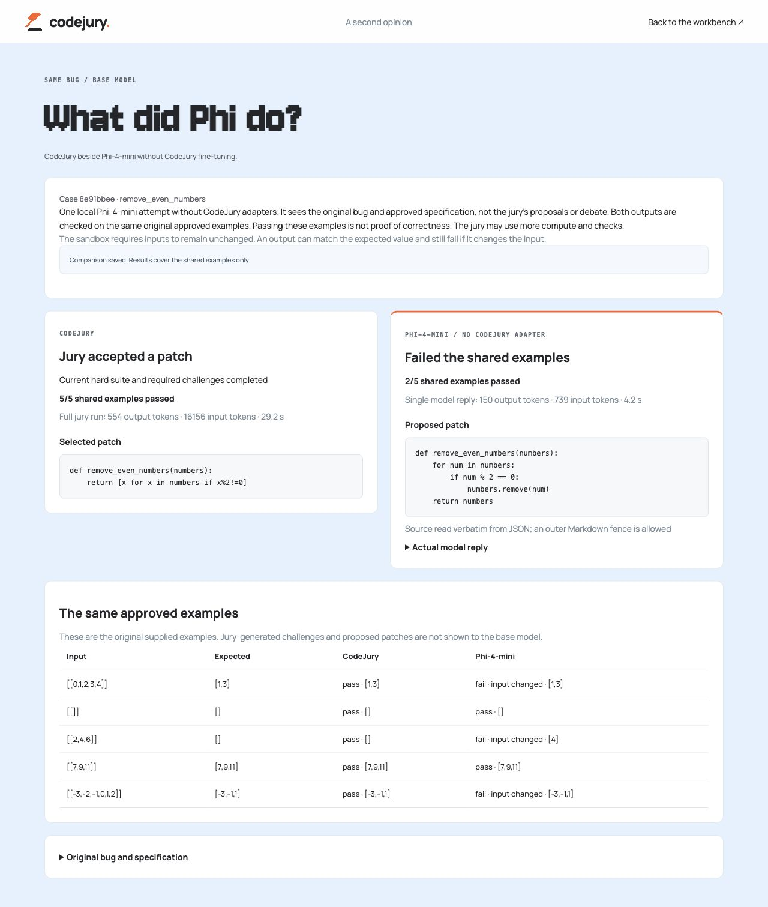

# A live base-model comparison for each finished case

After a supported or unresolved jury result, **Compare with base Phi-4-mini**
opens `/comparison.html?run=<run-id>` in a separate tab, preserving the original
repair desk. The page first loads the actual finished case. Clicking **Run
Phi-4-mini without fine-tuning** starts one local attempt, then shows the stored
reply and source beside CodeJury's selected patch (or its unresolved outcome).

The base is the same installed four-bit Phi-4-mini instruction model, with role
`raw` and a null adapter hash. It receives only the original buggy source,
signature, contract, domains, approved requirements and original supplied examples.
The jury's proposals, revisions, debate and generated challenges are absent from
its prompt. Quick case's interpreted-specification authority label is preserved.
There is no cloud request, download, extra training or alternate model.
The comparison requires the same frozen model registry as the parent jury run.

One attempt uses seed 17, up to 1,024 output tokens, the existing 4,096-token context
limit and a two-minute generation/checking deadline. It uses the global native
compute lease and the same worker slot as jury repairs. Busy compute leaves the
case unstarted and retryable. Duplicate submissions reuse the running or saved
comparison. Reopening the page only reads it. Interrupted work is marked as an
error after a server restart rather than silently repeated.

A single outer JSON Markdown fence is tolerated. The source field is taken
verbatim; metadata is ignored. Prose, multiple proposals and duplicate JSON keys
are not salvaged. The full actual reply stays expandable, including unusable
replies. Source extraction never edits or repairs the model's code.

Both outputs are evaluated in the existing Docker sandbox on the exact same
original supplied authoritative tests. Static/interface restrictions, registered
oracles, exceptions, timeouts and input-purity checks still apply. The table shows
actual outputs and marks **input changed** when mutation causes a failure. No
candidate code runs on the host. The comparison has its own stored check results
and does not alter the jury's verdict, tests or ledger.

Passing these examples does not establish hidden-test correctness. This is a
one-shot comparison, not matched actual compute: CodeJury can use multiple roles,
retries, search and additional checks. The displayed jury time is its full original
run; base-model time is the single recorded generation. Startup and extra comparison
checking are not included in that generation figure.

## Endpoints and storage

- `GET /s2x/runs/{run_id}/baseline` reads the original case and saved comparison.
- `POST /s2x/runs/{run_id}/baseline` admits at most one base-model attempt.
- The canonical Stage 2 wire schema remains unchanged. Comparison responses use
  `comparison_version: 1`.
- Both endpoints enforce the existing local Host/Origin check. Foreign requests
  cannot start a job or retrieve comparison source.
- Results live in the parent runtime's ignored `comparisons/comparisons.sqlite3`,
  with mode 600. The service recovers interrupted records during server startup.

## Verification

The genuine local case `run-0ec6f5f2fa2e47adb9cf572c8e91bbee`
(`remove_even_numbers`) was used for browser verification. The existing jury
selected a list-comprehension patch; it passed 5/5 shared examples. The raw model
returned its actual 150-token proposal after 4.2 seconds and passed 2/5 examples.
Its in-place list removal both skipped an even number and mutated inputs. Correct
returned values with changed inputs remain failures. These are mechanics results
for this one case, not a new accuracy benchmark.

Reloading the comparison reopened the saved reply without another generation.
Fourteen backend tests cover original-input isolation, raw identity, frozen-model
matching, idempotent/concurrent admission, busy compute, restart recovery,
input-mutation failures, incomplete checks and local endpoint access. Seven
frontend tests cover result labels, identifiers, API routing, failure messages and
the explicit-start behavior. The final full suites passed **658 backend tests with
nine skipped**, and **92 frontend tests**. Both existing contract validators passed;
the frozen Stage 2 schema hash is unchanged. A new genuine Bubble-sort demo run
finished with a supported patch, and its verdict link opened the comparison page
for that exact run without starting base-model inference on page load.

See the [general limitations and benchmark audit](current-limitations-and-baseline-audit.md)
for the broader comparison.
